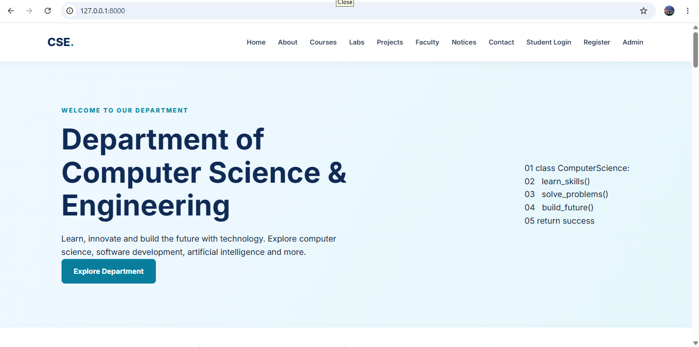
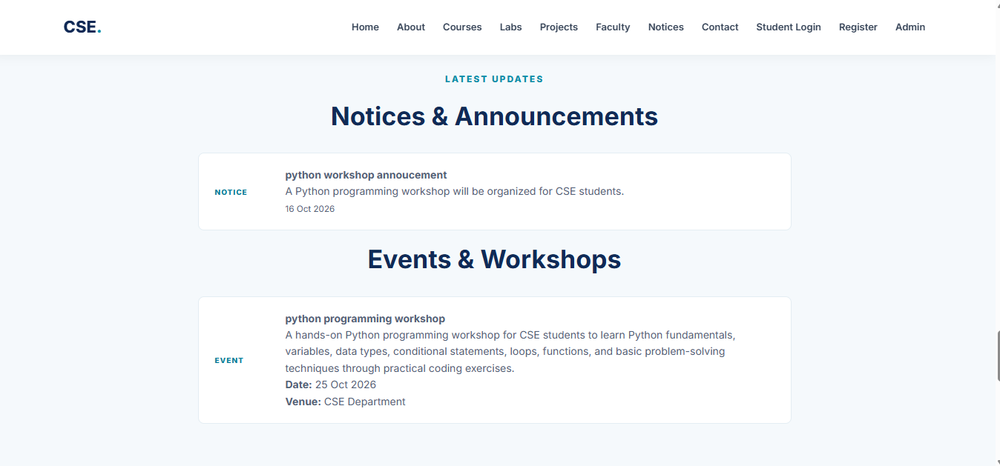
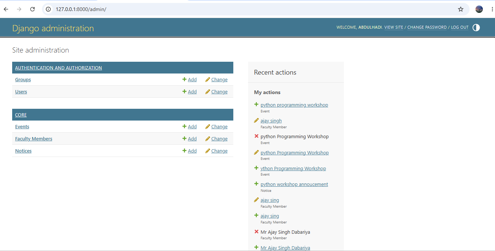

# CSE Department Website — Mewar University

A Django-based Computer Science and Engineering (CSE) Department Website with a Student Portal.

## About the Project

This project provides a central platform for students and visitors to explore department information, courses, faculty, notices, and events. It also includes student registration, login, and profile management.

## Features

- Department homepage and information
- Courses and academic subjects
- Faculty information
- Notices and upcoming events
- Student registration and login
- Student dashboard and profile editing
- Django admin panel for managing website content
- Responsive website design

## Technology Stack

- **Backend:** Python, Django
- **Frontend:** HTML, CSS
- **Database:** SQLite
- **Tools:** Visual Studio Code, Git, GitHub

## Project Structure

- `config/` — Django project configuration
- `core/` — Main application, views, models, and templates
- `static/` — CSS and other static assets
- `screenshots/` — Project screenshots
- `manage.py` — Django management utility
- `requirements.txt` — Python dependencies

## Getting Started

### 1. Clone the repository

```bash
git clone https://github.com/lonehadi709-png/CSE-Department-Website.git
cd CSE-Department-Website
```

### 2. Create and activate a virtual environment

On Windows:

```powershell
python -m venv venv
.\venv\Scripts\Activate.ps1
```

### 3. Install dependencies

```bash
pip install -r requirements.txt
```

### 4. Set the Django secret key

In PowerShell, generate a new key:

```powershell
python -c "import secrets; print(secrets.token_urlsafe(50))"
```

Copy the generated key privately, then set it in the same terminal session:

```powershell
$env:DJANGO_SECRET_KEY = "PASTE_YOUR_NEW_KEY_HERE"
```

Do not publish your secret key.

### 5. Run database migrations

```bash
python manage.py migrate
```

### 6. Start the development server

```bash
python manage.py runserver
```

Open `http://127.0.0.1:8000/` in your browser.

## Screenshots

See the `screenshots/` folder for images of the homepage, notices and events, and admin panel.

## Purpose

Developed as an academic project to demonstrate Django web development, database integration, authentication, and website content management.

## Author

**Abdul Hadi**

GitHub: [@lonehadi709-png](https://github.com/lonehadi709-png)

## Website Screenshots

### 1. Homepage


### 2. Notices and Events


### 3. Admin Panel


